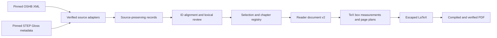

# Pipeline and contracts

The local app and CLI share the same Python services. The original design is in
[python-app-plan.md](python-app-plan.md); the print contract is in
[reference-page-spec.md](reference-page-spec.md).

## Implemented modules

| Module | Responsibility |
| --- | --- |
| `models.py` | Strict Pydantic settings, frozen source records, reader document |
| `sources.py` | Pinned acquisition, hash checks, OSIS/TSV adapters, canonical exports |
| `greek.py` | MorphGNT/Rahlfs/TBESG parsing and explicit Open Scriptures lexical crosswalk |
| `editorial.py` | Crosswalk candidates, decisions, frequency, stable chapter help labels |
| `appendix.py` | Hebrew/Greek sort keys and the source-traceable union of selected passage helps |
| `book_helps.py` | Versioned whole-book editorial help files and source compatibility checks |
| `word_classes.py` | Source-morphology display categories and preset word-color palette |
| `tex.py` | Explicit language runs, TeX measurement, pagination, bounded compiler, PDF checks |
| `service.py` | Shared inspect/build/doctor use cases and reproducibility bundles |
| `store.py` | SQLite project revisions, durable job snapshots, atomic claims |
| `jobs.py` | One separate POSIX worker per workspace; cancellation and recovery |
| `cli.py` | Argparse commands; JSON/TOML project input |
| `web/` | FastAPI routes, escaped Jinja2 page, static JS/CSS, native PDF preview |
| `render.py` | Backward-compatible synthetic v1 JSON-to-TeX specimen |

Rendering reads only local verified sources. Source acquisition never occurs as
an implicit side effect of a build. There is no ORM, hosted database, JavaScript
build pipeline, or model-generated lexical content.

## Records and identity

`ProjectConfig` has schema version 2, name, book/passage, selection policy, reading
and accent policy, known entries, per-anchor decisions, and validated typography.
`examples/reference.project.json` is a minimal example. `bible-reader init` writes
all defaults. Unknown settings are rejected. Project saves use an integer revision;
a stale tab cannot overwrite newer work.

Source `Verse` records preserve ordered `Token`s and serialized source annotations.
Greek adapters add `source_record` for original non-XML rows/units and explicit
`lexical_keys` for published lexical links. Book identities select a pinned
edition/witness and its versification. `John` selects SBLGNT; `LXXProv` and `Prov`
remain separate Greek and Hebrew sources. Greek records retain `grc`, use LTR
rendering with Gentium Plus, and bind TBESG/crosswalk hashes in portable help files.
See [Greek sources](greek-sources.md) for preservation, partial witnesses, lexical
coverage, and license details. The following OSHB-specific behavior remains scoped
to the Hebrew/Aramaic adapter.

A token keeps its OSHB ID, raw surface, lemma/morphology codes, word/separator kind,
normal/ketiv/qere reading, language, and source XML. Display strings remove slash
segmentation. The default `hide` accent policy removes only U+0591–U+05AF;
`preserve` retains source accents. `consonants-only` hides Hebrew combining marks
and punctuation. The existing `consonants` setting hides Hebrew combining marks
and punctuation except maqqef and is labeled **Consonants + maqqef**;
`consonants-maqqef-sof-pasuq` retains maqqef and sof pasuq while hiding the other
Hebrew marks and punctuation. Other-script characters and section letters remain
intact. Hidden separator tokens remain in the document with an empty display
surface; TeX skips them so hidden maqqef becomes ordinary word spacing. These policies apply
to scripture and review surfaces; lexical headwords retain their source pointing.
The chosen transformation is recorded in the source lock and credits. Raw surfaces
remain unchanged. Source IDs are interpreted within the pinned book/revision in the lock.
No source Unicode normalization or visual string reversal occurs.

Reader tokens also retain raw `morph`, a derived `word_class` (or null), and
`word_class_source` evidence. Classes follow the [OSHB morphology codes](https://hb.openscriptures.org/parsing/HebrewMorphologyCodes.html):
one language prefix applies to the full slash-separated analysis. Attached
conjunction/preposition/article prefixes and suffixes share the main component's
class; multiple main components or unknown codes remain unclassified. Cardinal
and ordinal adjective codes use the `number` display category. Confirmed OSHB
proper names or existing STEP name evidence use `name`, including omitted helps;
mixed candidates do not establish a name until a name entry is chosen.
`layout.word_colors` defaults to `auto` (no color) or enables `word-class`.
`layout.word_color_overrides` maps supported classes to `auto` or validated hex
colors. These settings affect presentation independently of help selection.

Each numeric lemma component maps to an anchor `<source-token-id>:<component-index>`.
Under the default review policy, exact extended IDs resolve only when a single
lexicon candidate exists; base-ID fallbacks and multiple candidates require review.
`Entry` IDs are qualified by `step:` and interpreted with the pinned lexicon revision. Only metadata and
STEP's short Gloss column are imported; `definition` remains empty.

`gloss_selection` defaults to `reviewed`, preserving explicit review of ambiguous
and base-ID matches. Opting into `first-entry` selects the first source candidate
in pinned STEP row order as the default, before applying saved decisions. Review
rows retain every candidate and record `alignment_status` separately from the
effective selection `status`, plus `choice_method` (`exact`, `first-entry`,
`decision`, or `unresolved`). The method and project configuration distinguish
this reader-selected policy from a contextual sense choice. Missing mappings
remain unmatched and name exclusion still applies. Resetting helps clears the
project's `decisions` and sets `gloss_selection` to `first-entry` in one
revision-checked settings update. The browser switches the selector before saving
and shows progress through the save and review refresh. Save failures restore the
previous selector; refresh failures report that the reset was saved. All other
settings, known-word exclusions, source records, and existing build snapshots remain intact.

A review row records candidates, chosen entry, status, reason, source/display
surface, morphology, reading, book frequency, selection, and help ID/label. Decisions
include action, optional supported entry ID, optional editorial gloss, and reason.
An exclusion is explicit and remains in the report. Missing source anchors or
incompatible entry choices fail rather than silently discarding stale decisions.

Names are excluded after alignment and editorial choices, before chapter help
registration, in every selection mode. OSHB noun type `Np` identifies proper
names; STEP's `N:` classification identifies names independently of language.
Parallel OSHB slash-separated lemma/morphology segments identify individual
lexical components where possible, so a neighboring common component retains
its help. Mixed name/common candidates remain ambiguous until an entry is chosen;
all-name candidate sets can be omitted without choosing between named identities.
Review rows retain raw morphology, component morphology, candidates, alignment
status, and explicit name-omission evidence. Existing inclusion decisions remain
inspectable history but cannot restore name helps. New inclusion attempts fail,
and book-wide inclusions report and skip name occurrences.

Lexical review can expand a decision to every matching word in the selected book.
A separate consonant key removes Hebrew marks/punctuation and slash segmentation
from the raw surface; prefixes/suffixes, logical order, and source Unicode remain
intact. MorphGNT instead supplies its unpunctuated `word` column as a separate
`spelling_key`, preserving accents and case while display retains punctuation.
The same effective spelling key controls bulk matches, review keys, and word
counts; sources without a separate spelling retain the surface-derived key.
Matching stays within a language and includes both K/Q records and words
outside the current passage. Each compatible lexical component receives an
ordinary per-anchor decision, replacing earlier edits. Components without the
chosen entry in their pinned crosswalk candidates are reported and left unchanged.
Review rows include the key and whole-book word count independently of lemma
frequency. The API saves the expanded configuration in one revision-checked update;
existing build snapshots remain immutable.

The lexical review grid and cards share per-anchor draft editors. Page submission
uses `POST /api/projects/{id}/decisions/batch`, with a project revision and up to
200 explicit anchor/decision/scope edits (the UI offers up to 160 rows per page).
The editorial service loads the pinned sources once for expansion, validates the
combined document, and saves one project revision. Duplicate anchors and
conflicting overlapping book/occurrence choices fail before persistence. Applied
and unsupported anchors are reported once each. Unresolved choices remain
explicit, and existing immutable build snapshots retain their saved decisions.
Browser drafts remain in memory across paging, filters, view switches, review
refreshes, and other row saves; they are never committed implicitly by a build.

Book help files use format `bible-reader-book-helps`, schema version 1. They store
the book, OSHB and STEP identities/revisions/artifact hashes, default gloss policy,
and all per-anchor decisions with their reasons. They contain no source text or
dictionary entries. Save/load validates every anchor and candidate throughout
the book, independent of the current passage and reading policy. Unresolved
choices stay unresolved; historical name decisions remain inspectable and cannot
enable name helps. Loading replaces the destination's decisions and default gloss
policy, preserving all other settings. The web API exposes revision-checked
`GET /api/projects/{id}/helps?revision=N` and `POST /api/projects/{id}/helps`
(`revision`, `helps`), saving one atomic project revision. Invalid files never
partially apply. The CLI `helps save/load` shares this service and writes a new
file, refusing existing outputs. Projects and files allow 100,000 decisions;
help files and web request bodies are limited to 64 MB.

The chapter registry is computed before filtering the requested passage, from the
same selected chapters and settings. General help identity includes lexical entry,
stem, and gloss. The reference fixture supplies separate observed slots where the
same lexeme has more than one note. Altered reference helps receive new labels.
Each page projects the registry and repeats just its referenced helps, once per
chapter-qualified help identity. Printed numbers are not lexical identities.

The top-level `lexicon_appendix` and `lexicon_only` settings default to false. When either is enabled,
the reader document's `lexicon_appendix` list unions the passage's selected helps,
deduplicating by source entry (or unresolved source lemma), exact headword, stem,
and gloss. Each entry retains its source ID, source description, editorial/status
metadata, and originating chapter-qualified `help_ids`. It reuses footnote
selection after book-frequency, known-word, editorial, and name rules; it neither
selects additional book words nor bypasses unresolved-help checks. A separate
Hebrew sort key ignores marks/punctuation and folds final letters into their
ordinary forms without modifying source/display text. Equal keys use source ID,
stem, and gloss as deterministic tie-breakers.

The final TeX inserts the lexicon before the credits in four left-to-right columns,
using `multicol` with bidi's explicit column direction. Each entry places its RTL
Hebrew headword on the left and LTR English stem/gloss on the right, on the same
baseline. Glosses share the stem-label size (half `notes_pt`); hanging indents,
zero paragraph spacing, and a 3 mm column gap keep the layout compact. The heading
includes both book names and the selected passage. TeX balances columns and
continues long glosses across columns/pages. The scripture's measured page plans
and page-local notes are unchanged in reader builds. Named PDF destinations identify the lexicon,
every entry, and the credits, so PDF checks verify entry coverage, placement,
page counts, and embedded fonts across all pages. Enabled exports also contain
`lexicon-appendix.json`; PDF diagnostics distinguish reader, appendix, and credits
pages. The browser and CLI share the saved setting, and the CLI offers explicit
`--lexicon-appendix` / `--no-lexicon-appendix` build overrides.

`lexicon_only` builds derive exactly the same selected helps but skip scripture
measurements and emit an empty scripture page plan. They print the lexicon and
source credits, with folios starting at `layout.first_folio`. PDF validation still
checks all lexicon destinations, section boundaries, overflow, and embedded fonts;
the source verse count remains available as coverage metadata. TeX-only exports
load the required TeX packages once to retain dependency hashes without measuring
scripture. CLI `--lexicon-only` / `--no-lexicon-only` override the saved mode.

`ReaderDocument` version 2 contains resolved config, ordered verses/tokens, referenced
helps, review rows, chapter registry, source lock, and warnings. The source lock
contains actual artifact hashes and upstream revisions. `page-plan.json` contains
verse blocks/fragments, first/last references, folios, measured heights in TeX scaled points,
and unique help IDs per page. Each candidate's complete page height includes its
actual running head and separator spacing, measured using the same box assembly
as final output. Fit is checked against TeX's usable text height; there is no fixed
header allowance. Final TeX uses exactly those boxes, blocks, and page breaks.
Continuous mode can split ordinary verses at legal word boundaries, recording
`token_start`, `token_end` (exclusive), and `continued` on fragments. References
can span successive pages; validation reconstructs every source verse's exact
ordered tokens and checks each page's marker destinations. Continuous chapter
openings can split once TeX measures at least two actual text lines beside the
badge; `chapter_lines` records that measurement for the last paragraph on a page
(zero for a paragraph without a chapter opening). Separate-verse blocks remain
indivisible. `layout.verse_layout` selects continuous
justified RTL paragraphs with inline verse numbers, or separately started,
right-aligned verse paragraphs with a number gutter. Chapter boxes reserve the
first two lines in continuous mode and the first two verses in verse-per-line mode.
Measurements and the final PDF use the same selected construction. Saved projects
and immutable build snapshots retain the choice; omitted settings default to
continuous through project validation.

A continuous one-line chapter opening is legal only when its chapter or the
selected passage ends. Prefix lookahead runs before validating the whole-group
fallback, since the following verse can supply the second actual line. If no
prefix can do so, the planner moves the opening intact to the next page or
reports overflow. The same chapter-break rule applies during rebalancing.
Final page assembly stretches space above the apparatus separator so the notes
end at the bottom margin on every reader page; natural measured heights and page
budgets still include the same minimum separator clearance.

After greedy pagination, continuous mode revisits non-final chapter-ending pages
with more than 1.25 lines of unused height. It measures at most 40 legal cuts in
the preceding page's last three verses, minimizing the largest unused height
across the two pages, then total unused height, then moved token count. If that
leaves a large gap, a three-page fallback considers the preceding two boundaries:
at most eight feasible cuts per boundary and 64 middle-page combinations, measured
in batches of 32. A move must improve the largest gap by at least 1 pt. Each
candidate uses its actual folio, merges contiguous source fragments, recomputes
page-local helps, and retains the two-line chapter-box minimum. Page count, fonts,
and leading remain fixed; verse-per-line and final reader pages are unchanged.

`layout.paper` defaults to `reader` (140 × 216 mm). Existing named profiles retain
their dimensions. Selecting `custom` requires validated `paper_width_mm` and
`paper_height_mm`; project revisions, immutable build snapshots, and reader JSON
retain them. A shared dimension resolver supplies measurement, page budgets, and
final PDF geometry, with 10 mm margins for reader/custom paper.

## Persistence and reproducibility

SQLite stores projects/jobs only; raw sources remain the authority. Imports also
write rebuildable canonical JSONL and lexical JSON. At current corpus sizes,
verified parsing is fast enough without a second persistent lookup index.
The worker batches candidate measurements per page; it does not have a persistent
measurement cache. Build results are immutable directories with complete manifests.

Reader JSON, page plans, registries, and TeX are deterministic under the same inputs
and environment. PDF bytes and logs are not promised identical across installations;
font/engine/loaded-TeX-input hashes are recorded for comparison. The output PDF is
checked for page count, complete ordered verse coverage, actual marker counts,
actual page-local hyperlink destinations, font embedding, missing glyphs, and
horizontal/vertical overflow. Visual inspection complements these checks.

## v1 compatibility

`examples/demo.reader.json` remains explicitly synthetic. Calling the CLI with
that filename and `--output` uses its strict schema-1 renderer: document title,
language, source notice, entries, and verses of tokens with already-selected entry
IDs. It retains occurrence numbering and passage-end notes. Production source
import, editorial review, and PDF builds all use schema 2.
