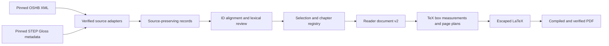

# Pipeline and contracts

The local app and CLI share the same Python services. The original design is in
[python-app-plan.md](python-app-plan.md); the print contract is in
[reference-page-spec.md](reference-page-spec.md).

## Implemented modules

| Module | Responsibility |
| --- | --- |
| `models.py` | Strict Pydantic settings, frozen source records, reader document |
| `sources.py` | Pinned acquisition, hash checks, OSIS/TSV adapters, canonical exports |
| `editorial.py` | Crosswalk candidates, decisions, frequency, stable chapter help labels |
| `tex.py` | Explicit language runs, TeX measurement, pagination, bounded compiler, PDF checks |
| `service.py` | Shared inspect/build/doctor use cases and reproducibility bundles |
| `store.py` | SQLite project revisions, durable job snapshots, atomic claims |
| `jobs.py` | One separate POSIX worker per workspace; cancellation and recovery |
| `cli.py` | Argparse commands; JSON/TOML project input |
| `web/` | FastAPI routes, escaped Jinja2 page, static JS/CSS, native PDF preview |
| `render.py` | Backward-compatible synthetic v1 JSON-to-TeX specimen |

Rendering reads only local verified sources. Source acquisition never occurs as
an implicit side effect of a build. There is no ORM, hosted database, JavaScript
build pipeline, or model-generated lexical content.

## Records and identity

`ProjectConfig` has schema version 2, name, book/passage, selection policy, reading
and accent policy, known entries, per-anchor decisions, and validated typography.
`examples/reference.project.json` is a minimal example. `bible-reader init` writes
all defaults. Unknown settings are rejected. Project saves use an integer revision;
a stale tab cannot overwrite newer work.

Source `Verse` records preserve ordered `Token`s and serialized source annotations.
A token keeps its OSHB ID, raw surface, lemma/morphology codes, word/separator kind,
normal/ketiv/qere reading, language, and source XML. Display strings remove slash
segmentation; optional accent hiding removes only U+0591–U+05AF. Raw surfaces remain
unchanged. Source IDs are interpreted within the pinned book/revision in the lock.
No source Unicode normalization or visual string reversal occurs.

Each numeric lemma component maps to an anchor `<source-token-id>:<component-index>`.
Exact extended IDs can resolve only when a single lexicon candidate exists. Base-ID
fallbacks and multiple candidates require explicit review. `Entry` IDs are qualified
by `step:` and interpreted with the pinned lexicon revision. Only metadata and
STEP's short Gloss column are imported; `definition` remains empty.

A review row records candidates, chosen entry, status, reason, source/display
surface, morphology, reading, book frequency, selection, and help ID/label. Decisions
include action, optional supported entry ID, optional editorial gloss, and reason.
An exclusion is explicit and remains in the report. Missing source anchors or
incompatible entry choices fail rather than silently discarding stale decisions.

The chapter registry is computed before filtering the requested passage, from the
same selected chapters and settings. General help identity includes lexical entry,
stem, and gloss. The reference fixture supplies separate observed slots where the
same lexeme has more than one note. Altered reference helps receive new labels.
Each page projects the registry and repeats just its referenced helps, once per
chapter-qualified help identity. Printed numbers are not lexical identities.

`ReaderDocument` version 2 contains resolved config, ordered verses/tokens, referenced
helps, review rows, chapter registry, source lock, and warnings. The source lock
contains actual artifact hashes and upstream revisions. `page-plan.json` contains
verse blocks, first/last references, folios, measured heights in TeX scaled points,
and unique help IDs per page. Each candidate's complete page height includes its
actual running head and separator spacing, measured using the same box assembly
as final output. Fit is checked against TeX's usable text height; there is no fixed
header allowance. Final TeX uses exactly those boxes, blocks, and page breaks.
Verse blocks are pagination units. `layout.verse_layout` selects continuous
justified RTL paragraphs with inline verse numbers, or separately started,
right-aligned verse paragraphs with a number gutter. Chapter boxes reserve the
first two lines in continuous mode and the first two verses in verse-per-line mode.
Measurements and the final PDF use the same selected construction. Saved projects
and immutable build snapshots retain the choice; omitted settings default to
continuous through project validation.

`layout.paper` defaults to `reader` (140 × 216 mm). Existing named profiles retain
their dimensions. Selecting `custom` requires validated `paper_width_mm` and
`paper_height_mm`; project revisions, immutable build snapshots, and reader JSON
retain them. A shared dimension resolver supplies measurement, page budgets, and
final PDF geometry, with 10 mm margins for reader/custom paper.

## Persistence and reproducibility

SQLite stores projects/jobs only; raw sources remain the authority. Imports also
write rebuildable canonical JSONL and lexical JSON. At current corpus sizes,
verified parsing is fast enough without a second persistent lookup index.
The worker batches candidate measurements per page; it does not have a persistent
measurement cache. Build results are immutable directories with complete manifests.

Reader JSON, page plans, registries, and TeX are deterministic under the same inputs
and environment. PDF bytes and logs are not promised identical across installations;
font/engine/loaded-TeX-input hashes are recorded for comparison. The output PDF is
checked for page count, complete ordered verse coverage, actual marker counts,
actual page-local hyperlink destinations, font embedding, missing glyphs, and
horizontal/vertical overflow. Visual inspection complements these checks.

## v1 compatibility

`examples/demo.reader.json` remains explicitly synthetic. Calling the CLI with
that filename and `--output` uses its strict schema-1 renderer: document title,
language, source notice, entries, and verses of tokens with already-selected entry
IDs. It retains occurrence numbering and passage-end notes. Production source
import, editorial review, and PDF builds all use schema 2.
